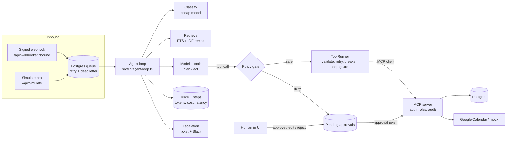

# Architecture

## The agent loop (`src/lib/agent/loop.ts`)
One readable function, no framework. For each message:
1. **Identify the sender** from channel metadata, never from message text. Mint a short-lived MCP token scoped to that customer (`cust` claim); unknown senders get `unverified`, which matches no orders.
2. **Classify** (cheap model): intent, urgency, anger, legal/safety, injection suspected, order ids. Invalid output fails safe to "needs human".
3. **Retrieve**: query the documents, record query, variant, chunks, scores and a confidence value in the trace.
4. **Plan/act** (up to `MAX_AGENT_STEPS`, `MAX_TOKENS_PER_REQUEST`): the model sees the message, classification and passages (all wrapped as untrusted data) and the tools the MCP server lists for the `agent` role, plus a `respond` pseudo-tool. Every tool call goes through policy first.
5. **Deterministic checks after the model** (cannot be argued away): escalation rules (angry, legal/safety, out of scope, low retrieval confidence, tool failure, loop, step/token cap), citation validation (cited ids must be among retrieved chunks), and an "ungrounded answer" rule. If it cannot ground or a tool failed, the customer gets an honest holding reply instead of the model's claim.
6. **Draft and queue**: `draft_reply` runs; `send_reply` is held as a pending approval. Escalations also create a `needs_human` ticket and a Slack message.
7. **Trace** every step with tokens, USD cost and latency; any exception becomes an escalation, never a silent drop.

## Approval gate (`policy.ts`, `approvals.ts`)
`evaluateToolCall` is a pure function: `safe`, `approval` or `deny`. Always gated: `issue_refund`, `send_reply`, `cancel_booking`; anything with a monetary value above `APPROVAL_VALUE_THRESHOLD`; denied outright: destructive/unknown tools. A gated call is **not executed**: it is stored with the model's reasoning and evidence. On approval the system mints (a) an `operator` token for the approving human and (b) an **approval token bound to the tool and the SHA-256 of the exact arguments**; the MCP server refuses these tools without a valid one. The pending→approved transition is one atomic UPDATE and execution uses the idempotency key `approval-<id>`, so double clicks, replays and duplicate delivery run once. Editing arguments re-binds the token to the edited arguments.

## MCP (`mcp-server/`)
The business tools are a real MCP server built on the official SDK. The agent calls them **only through an MCP client** (`mcp-server/client.ts`, in-memory transport so it also works on serverless). The same server runs over stdio (`pnpm mcp`) and Streamable HTTP (`pnpm mcp:http`) for Claude Desktop/Code. Inside the server, for every call, in order: authenticate bearer token (missing/expired/invalid → denied), per-role allowlist (the agent role cannot even list `issue_refund`), approval-token check, argument validation (zod), fault injection (test mode), execute, **audit**. Denied calls execute nothing and are logged. The audit table has triggers that reject UPDATE and DELETE.

## Retrieval (`src/lib/retrieval/`)
Documents are chunked twice (fixed-size and heading-aware) so variants can be compared from one ingest. Search is Postgres full-text (OR query), optionally fused (RRF) with vector search when an embeddings key exists, then an IDF-weighted heuristic reranker (or an LLM reranker). "Confidence" is the IDF-weighted share of the question's content terms found in the best chunk; below `MIN_RETRIEVAL_CONFIDENCE` the agent says it does not know and escalates. Retrieval is evaluated on its own (`pnpm eval:retrieval`).

## Failure handling (`toolrunner.ts`, `breaker.ts`)
Arguments are validated against the tool's schema before any call. Retries (exponential backoff, capped) only for pure reads or calls carrying an idempotency key; a non-idempotent call without a key is never retried. A per-tool circuit breaker (3 failures, 30 s cooldown) fast-fails. The same (tool, args) more than twice stops the loop. Partial results are flagged and never treated as complete. Anything unrecoverable ends in escalation with an honest message.

## Trade-offs
- **Gate everything outbound** costs a human click per reply but makes "the agent never sent anything unreviewed" simple to state and test. A client may relax it for low-risk answers after shadow mode.
- **Per-customer token scope** instead of trusting the agent to pass a customer id: the model can be fooled, the token cannot.
- **Rule-based mock LLM**: free, deterministic CI and a demo that cannot run up a bill, but it is not a model, so its eval numbers say little about Claude. The harness is built so the same cases run unchanged against the real provider.
- **PGlite locally, Postgres in production**: zero setup, one SQL dialect; the cost is a ~14 s WASM start (tests are slow-ish).
- **IDF heuristic instead of embeddings** as the measured default: it is explainable and free, but it cannot bridge vocabulary the synonyms table does not cover. Vector search is implemented and unmeasured.
- **In-process circuit breaker**: fine for one instance; on serverless each instance has its own state.
