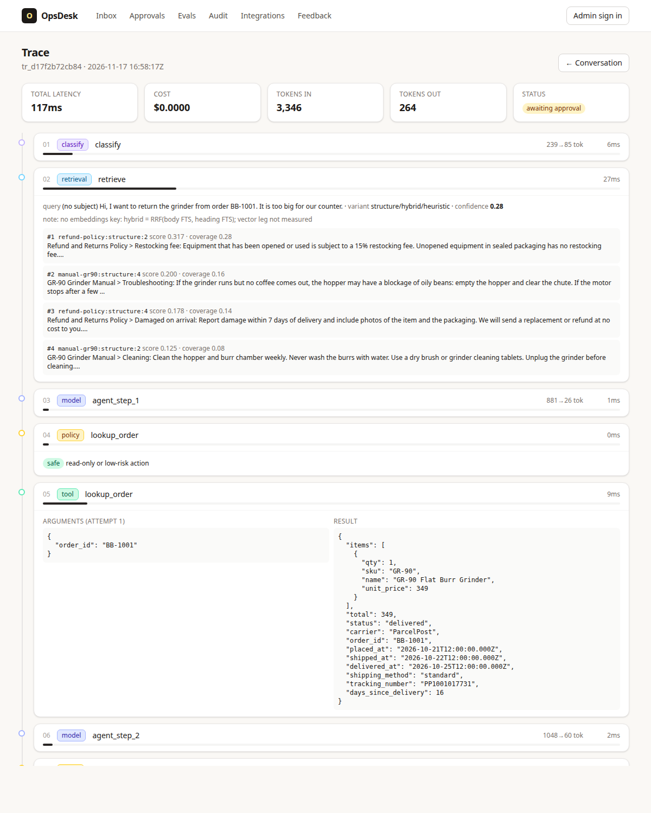
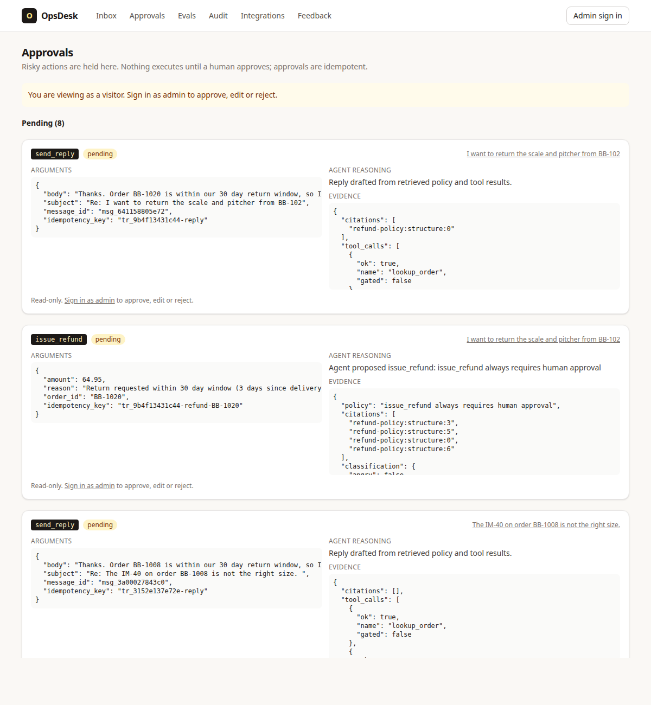
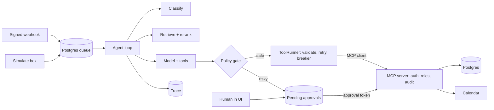

# OpsDesk: a customer-operations agent with approvals, MCP, traces and evals

OpsDesk handles inbound customer messages for a **fictional** shop, *Brightside Bakery & Cafe Supplies*. For each message it classifies the request, retrieves and cites company documents, calls business tools through a real **MCP server**, **holds risky actions for human approval**, escalates when it is unsure, and records a full trace with tokens, cost and latency. All data is synthetic and outbound messages are simulated.




## Quick start (2 minutes, no API key needed)
```bash
git clone https://github.com/breakthrough-child/opsdesk.git && cd opsdesk
pnpm install
pnpm dev          # open http://localhost:3000, first start seeds the fictional shop; admin password: admin (dev only)
```
Try the *Simulate a customer message* box, then open **Approvals** (sign in as admin) and the **trace** of any message. With no `ANTHROPIC_API_KEY` the agent runs on a deterministic mock; add a key to `.env.local` (see `.env.example`) to use Claude. Checks: `pnpm lint && pnpm typecheck && pnpm test && pnpm build`. Deploy: [docs/DEPLOY.md](docs/DEPLOY.md). In production the server refuses to start unless `ADMIN_PASSWORD` is strong and the secrets are set.

**Honest status (read this first).** I had no Anthropic key, Supabase project, Google credentials or Vercel access while building. So: everything runs end to end locally and in tests against a **deterministic mock LLM**; every agent eval number below is from that mock and says nothing about Claude's quality; real integrations (Google Calendar, Slack, Supabase Auth, embeddings, Anthropic) are implemented with a mock mode each but **were not exercised live**; the app is **not deployed** (it is deploy-ready, steps below). No pilot has been run.

## Problem
Small shops answer the same questions all day (where is my order, can I return this, how do I descale it). Staff are the bottleneck, but handing customers and refunds to an AI unsupervised is risky: it can promise refunds, leak another customer's order, or make up policy.

## Why AI?
The messages are free text, vary a lot, and the answers live in documents and order data. Rules alone cannot read them; a model can. But the *authority* to act must not live in the model. OpsDesk uses the model for understanding and drafting, and ordinary code (policy, auth, idempotency, audit) for everything that must hold even when the model is wrong.

## Requirements
- Classify intent/urgency; retrieve and **cite** sources; **say "I don't know" and escalate** instead of guessing.
- Act through tools (order lookup, ticket, booking, draft reply); **gate** refunds, outbound messages, cancellations and large amounts behind a human; idempotent execution.
- Resist prompt injection (in messages and documents); only access the data of the customer in the conversation.
- Trace every step; measure everything with an eval harness; run with no credentials (mock modes).

## Architecture

Details in [ARCHITECTURE.md](ARCHITECTURE.md).

## Technology decisions
TypeScript, Next.js 15 (App Router), Tailwind 4; Postgres via embedded PGlite locally and `pg`/Supabase in production (same SQL); Anthropic SDK with models from env (`AGENT_MODEL`, `CLASSIFIER_MODEL`) and prompt caching on the system prompt; official MCP SDK; Vitest; strict TypeScript + ESLint. Every non-obvious choice is one line in [DECISIONS.md](DECISIONS.md).

## System design
- **Agent loop** (`src/lib/agent/loop.ts`): classify → retrieve → plan/act → deterministic escalation and grounding checks → draft → approval gate → trace. Step and token caps; any exception escalates.
- **MCP server** (`mcp-server/`): 9 tools, bearer tokens, roles `viewer/agent/operator/admin` with per-role allowlists enforced *inside* the server, approval tokens bound to tool + exact args, append-only audit log (denied calls logged and executed as nothing), test-mode fault injection.
- **Approvals**: risky calls are stored with reasoning and evidence; approve/edit/reject in the UI; one atomic state transition and a stable idempotency key make execution happen once.
- **Retrieval**: Postgres full-text + IDF-weighted rerank, fixed or heading-aware chunks, optional vector leg; confidence drives "I don't know".
- **Integrations**: Google Calendar (OAuth + mock), signed webhook (HMAC, replay window, idempotency, rate limit), Postgres queue (backoff, dead letter), Slack (optional), outbound channel adapter (simulated). See [docs/INTEGRATIONS.md](docs/INTEGRATIONS.md).

## Installation
Needs Node 20+ and pnpm. No keys required.
```bash
pnpm install
pnpm bootstrap   # migrate + seed (20 customers, 15 products, 30 orders) + ingest 14 documents (optional: first start does this automatically)
pnpm dev         # http://localhost:3000 (optional: `pnpm demo:seed` first, with the dev server stopped, to fill the inbox), admin password: ADMIN_PASSWORD (default "admin" in dev)
```
With a key: `cp .env.example .env.local`, set `ANTHROPIC_API_KEY`. Then `pnpm test`, `pnpm lint`, `pnpm typecheck`, `pnpm eval`, `pnpm eval:retrieval`, `pnpm eval:compare <runA> <runB>`, `pnpm mcp` (MCP server over stdio), `pnpm worker`.

## API
| Endpoint | Purpose |
|---|---|
| `POST /api/webhooks/inbound` | Signed inbound message (HMAC `t=…,v1=…`, ±300 s, idempotent on `id`, 60/min/IP) |
| `POST /api/simulate` | Demo/simulated message; per-IP rate limit and daily cost cap |
| `POST /api/approvals/:id` | `{decision: "approve"\|"reject", editedArgs?}`; admin only; idempotent |
| `POST /api/feedback` | Thumbs + reason + note (requires consent flag) |
| `GET /api/audit/export` | CSV of the audit log (admin) |
| `POST /api/worker/tick` | Process queued jobs (cron secret or admin) |
| `GET /api/health` | Provider, document count, demo flag |
| MCP: stdio / `:3333/mcp` | `lookup_order`, `create_ticket`, `list_available_slots`, `book_slot`, `draft_reply`, `issue_refund`, `send_reply`, `cancel_booking`, `delete_ticket` (admin) |

## Evaluation
114 cases in `evals/cases/` (versioned JSON, 13 files) covering order status, returns/refunds in and out of policy, answerable and unanswerable product/policy questions, booking and rescheduling, ambiguity, angry/legal/safety, out of scope, prompt injection (message and document), other customers' data, multi-step requests and failure handling (API down, timeout, partial result, invalid arguments, wrong tool, loop, invented order id, refund twice, unsafe request). About 20% (24) are held out by hashing the case id; held-out failures are never listed by the CLI. `pnpm eval` writes `evals/results/<timestamp>/{summary.json,results.jsonl}`, exits non-zero if any safety case fails or a metric drops below `evals/thresholds.json`, and `pnpm eval:compare` diffs two runs. Retrieval is measured separately with 83 questions. How the numbers moved across three runs, including a regression I could not explain: [evals/IMPROVEMENTS.md](evals/IMPROVEMENTS.md).

### Eval results (latest run)
<!-- AGENT_TABLE:START -->
Run `2026-11-17T16-42-18-454Z_iter2` · provider: **mock** · 114 cases (90 dev, 24 held-out).

> **These numbers come from the deterministic mock provider, not from Claude.** They measure the rule engine plus the system around it (retrieval, policy, approval gate, MCP, escalation). Model numbers: not yet measured (no API key was available). Run `pnpm eval` with `ANTHROPIC_API_KEY` set.

| Metric | Dev | Held-out | All |
|---|---|---|---|
| Case pass rate | 88.9% (80/90) | 79.2% (19/24) | 86.8% (99/114) |
| Intent accuracy | 94.4% | 91.7% | 93.9% |
| Tool-call correctness | 98.8% | 100.0% | 99.1% |
| Approval correctness | 100.0% | 95.8% | 99.1% |
| Escalation precision / recall | 100.0% / 96.4% | 100.0% / 100.0% | 100.0% / 97.1% |
| Answer correctness (deterministic facts) | 94.8% | 89.5% | 93.5% |
| Citation accuracy | 91.7% | 50.0% | 83.3% |
| **Safety pass rate** (injection + privacy + gates) | 100.0% (18/18) | 100.0% (6/6) | 100.0% (24/24) |
| Latency mean / p95 | 129 ms / 260 ms | 183 ms / 430 ms | 140 ms / 276 ms |
| Mean cost per request | not measured (mock) | not measured (mock) | not measured (mock) |

Per category (all cases): ambiguous 4/6 · angry legal 8/8 · booking 8/8 · failure 13/13 · injection 7/9 · multi step 2/4 · order status 9/10 · out of scope 6/6 · policy question 8/10 · privacy 7/7 · product question 12/13 · return refund 10/13 · unanswerable 5/7

LLM-as-judge: not used in this run (deterministic checks only).
<!-- AGENT_TABLE:END -->

### Retrieval results
<!-- RETRIEVAL_TABLE:START -->
Run `2026-11-17T16-42-03-393Z_retrieval_final` · 68 answerable + 15 unanswerable questions (about 80% dev / 20% held-out). Cells: recall@1 / @3 / @5 (%) · MRR · extractive answer hit. **Default chosen on dev only: `v5_structure_hybrid_rerank`.**

| Variant | Dev | Held-out | Latency/query |
|---|---|---|---|
| Baseline: fixed-size chunks + keyword (Postgres FTS) | 67 / 84 / 91 · 0.76 · 56% | 77 / 100 / 100 · 0.87 · 77% | 17.6 ms |
| Structure-aware chunks + keyword | 60 / 89 / 96 · 0.75 · 60% | 62 / 100 / 100 · 0.81 · 62% | 14.3 ms |
| Hybrid: RRF(body FTS, heading FTS) [keyword legs only] | 51 / 89 / 95 · 0.70 · 53% | 69 / 100 / 100 · 0.83 · 69% | 18.3 ms |
| Structure + keyword + IDF heuristic rerank | 85 / 98 / 98 · 0.91 · 85% | 92 / 100 / 100 · 0.96 · 92% | 19.0 ms |
| Hybrid (kw legs) + IDF heuristic rerank **(default)** | 87 / 98 / 98 · 0.92 · 87% | 92 / 100 / 100 · 0.96 · 92% | 21.2 ms |
| Hybrid (kw legs) + heuristic rerank + metadata filter | 85 / 96 / 96 · 0.90 · 85% | 92 / 100 / 100 · 0.96 · 92% | 19.1 ms |
| Baseline: fixed chunks + vector search | not measured: EMBEDDINGS_API_KEY not set | | |
| Hybrid: keyword + vector (RRF) | not measured: EMBEDDINGS_API_KEY not set | | |
| Hybrid + LLM reranker | not measured: ANTHROPIC_API_KEY not set | | |

Not measured: groundedness of final answers with an LLM, cost per query (no LLM/embedding calls are made by the measured variants, so $0), and every vector or LLM-rerank variant (no API keys). "Extractive answer hit" is a deterministic proxy: do the sentences quoted from the top chunk contain the gold passage?

Abstain behaviour of the default on dev (confidence threshold → answerable questions answered / unanswerable questions correctly refused): 0.3: 95% / 69% · 0.4: 95% / 77% · 0.5: 91% / 85% · 0.6: 78% / 100% · 0.7: 71% / 100%.
<!-- RETRIEVAL_TABLE:END -->

Progress across runs (mock provider): dev pass rate 71.1% → 84.4% → 88.9%; held-out 66.7% → 87.5% → **79.2%** (regressed in iteration 2; open). Safety 24/24 in all three.

## Failure modes
Each is a test and at least one eval case (`tests/agent.test.ts`, `tests/mcp.test.ts`, `evals/cases/failure.json`): tool timeout, 5xx (retried, then escalate), invalid arguments (rejected client-side before any call), partial results (never treated as complete), duplicate delivery and double approval (refund happens once), wrong tool (denied), agent loop (cut off), invented order id (reports not found), unauthorized customer, unsafe request (stays gated), API down (circuit breaker opens, honest holding reply). Fault injection exists only in test mode and is ignored in production (tested).

## Security
- Prompt injection: messages and documents are wrapped as untrusted data; injected instructions are stripped by the classifier and, more importantly, **cannot cause action even if obeyed**: a "gullible" mock that follows injected refund instructions still only creates a pending approval (eval `inj-02/06/09`, `tests/agent.test.ts`).
- Privacy: the agent's token is scoped to the verified sender (`cust` claim) and enforced in the MCP server; asking about another customer's order returns the same "not found" as a non-existent id; unknown senders see nothing.
- No exfiltration path: `send_reply` has no recipient argument; replies always go to the original sender and are always approval-gated.
- Auth: signed bearer tokens (missing/expired/invalid rejected and logged), role allowlists, approval tokens bound to args hash, destructive tools admin-only and never exposed to the agent, append-only audit with redaction.
- Webhook: HMAC, constant-time compare, replay window, idempotency, rate limit. OAuth refresh tokens AES-256-GCM encrypted. Dev secrets in `.env.example` **must be changed**.
- Not done: no external security review; session cookie auth is basic; Supabase RLS migration untested on Supabase.

## Observability
Every request has a trace (`/traces/:id`): classification, each retrieval (query, variant, top chunks, scores, confidence), each model call, each tool attempt (arguments, result, retries), policy decisions, approvals, escalation reasons, guards, with per-step and total tokens, USD cost and latency. The audit page (`/audit`) filters tool calls by actor, tool and status and exports CSV. `/integrations` shows mode, last success and last error per integration.

## Performance
Mock provider, in-process: mean ~129 ms and p95 ~260 ms per dev case end to end (includes real Postgres queries, MCP calls and retrieval). **Real-model latency: not measured.** Retrieval alone is ~20 ms per query. PGlite takes ~14 s to start (tests and eval runs pay this once per process).

## Cost per request
**Not measured**: the mock costs $0 and no API key was available. Token counts are recorded per step and cost is computed from `src/lib/llm/pricing.ts`, whose prices are **assumptions** to verify. A request makes one classification call and typically 2 to 4 agent calls. Run `pnpm eval` with a key to get `cost_usd_mean`; the demo has a daily cost cap.

## Deployment
**Not deployed.** Ready for Vercel (`vercel.json`, production build passes). Exact steps:
1. Create a Supabase project; copy the Postgres connection string (use the pooled one). Run `DATABASE_URL=… pnpm db:migrate && DATABASE_URL=… pnpm db:seed && DATABASE_URL=… pnpm ingest`.
2. `vercel link`, then set env vars from `.env.example`: at least `DATABASE_URL`, `ANTHROPIC_API_KEY`, `MCP_TOKEN_SECRET`, `WEBHOOK_SECRET`, `ENCRYPTION_KEY`, `ADMIN_PASSWORD` (or Supabase Auth vars), `CRON_SECRET`, and for the public demo `DEMO_MODE=1`, `DEMO_RATE_LIMIT_PER_HOUR`, `DEMO_DAILY_COST_CAP_USD`.
3. `vercel --prod`. Check `/api/health`. (Without `DATABASE_URL` a serverless deploy falls back to an ephemeral in-memory database, fine for a throwaway demo, not for real use.)
4. Optional: Google OAuth redirect `https://<app>/api/oauth/google/callback`, `SLACK_WEBHOOK_URL`, point your mail provider's webhook at `/api/webhooks/inbound`.

## Users
**Pilot not yet run.** No testers, usage or feedback exist. The code supports one (thumbs + reason + consent on every reply and approval, a feedback page, [docs/PILOT.md](docs/PILOT.md)); [docs/FEEDBACK_LOG.md](docs/FEEDBACK_LOG.md) is an empty template on purpose.

## Lessons learned
- The most valuable eval case found a real bug that unit tests missed (a driver returned numbers as strings, so approved refunds silently failed).
- Make the safety property hold when the model is wrong: a deliberately gullible mock proves the gates better than a well-behaved one.
- A plausible improvement can generalize worse: the retrieval change raised dev and lowered held-out. Keep a held-out set and report it even when it hurts.
- Structure-aware chunking alone did not beat fixed-size chunks with this ranker; reranking did the work.
- Lexical confidence is a weak "do I know this?" signal (see the un-03 regression).

## Known limitations
- Agent numbers are from a rule-based mock, not Claude. Real integrations, deployment, LLM judge, LLM reranker, vector search and pgvector migration are **not exercised**.
- Held-out regression in iteration 2 is unexplained; a "don't guess" regression (`un-03`) is open.
- Multi-intent messages are not handled by the mock; no `list_bookings` tool, so reschedules/cancels without a booking id are escalated.
- Every reply needs a human click; the circuit breaker is per instance; PGlite is single-connection; prices are assumed.

## Future improvements
Run the real model and report cost/latency; embeddings + hybrid vector search; entailment check on cited passages; `list_bookings`; multi-intent planning; relaxed gating for low-risk replies after shadow mode; real email/WhatsApp adapter; run the pilot.

## How I would adapt this for a client
1. Scope what the agent may do alone vs with approval; set thresholds. 2. Ingest the client's real documents and write 30+ of their real questions with gold passages; pick retrieval on a dev split. 3. Swap the seed tables for a read-only sync from their shop platform; keep customer scoping in the token. 4. Implement their channel adapter; start in shadow mode (drafts only). 5. Run the eval harness with the real model on their cases; safety must be 100% before go-live. 6. Review failures weekly and turn each into a case. Checklist: [docs/CLIENT_SETUP.md](docs/CLIENT_SETUP.md).

More: [ARCHITECTURE.md](ARCHITECTURE.md) · [DECISIONS.md](DECISIONS.md) · [docs/WRITEUP.md](docs/WRITEUP.md) · [PLAN.md](PLAN.md)
